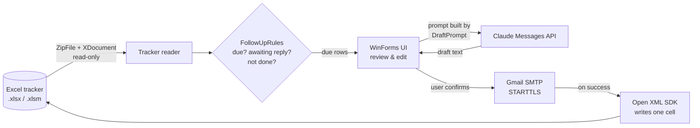

# Job Application Follow-Up Assistant

A Windows desktop app (C# / WinForms, .NET 9) that reads a job-application tracker in Excel, lists the applications that are due for a follow-up, drafts the follow-up email with the Claude API, and sends it through Gmail after the user has reviewed it. The row is then marked as done directly in the workbook.

[](https://github.com/Dhru1999/Auto-Follow-Up-Tool-Using-Claude-Code/actions/workflows/ci.yml)

## Why it exists

After a few dozen applications, following up becomes a bookkeeping problem: which ones are a week old, which already got an answer, which were already chased. I kept my applications in an Excel workbook, so the tool works on that file directly instead of asking me to move the data somewhere else.

It is a personal productivity tool built for one person's workflow and shared as a portfolio project. It is not a hosted service.

## What works today

| Feature | Status |
|---|---|
| Read `.xlsx` / `.xlsm` trackers, including macro-enabled ones, without Excel installed | Working |
| Tolerate messy headers (`Date of applied`, `company_emails`, `Repsonse received`, line breaks in header cells) | Working, unit-tested |
| Parse Excel serial dates, ISO dates and German `dd.MM.yyyy` text dates | Working, unit-tested |
| List applications due today **or overdue** with no reply, skipping rejected / withdrawn / already-followed-up rows | Working, unit-tested |
| Draft a short follow-up with the Claude Messages API, using a fixed tone profile | Working (needs an Anthropic API key) |
| Edit the draft, confirm, send via Gmail SMTP (CC to HR if present) | Working (needs a Gmail App Password) |
| Mark the row `Followup done = Yes` in the workbook without touching formulas, macros or formatting | Working |
| Store the Gmail App Password and API key encrypted per Windows user (DPAPI) | Working |

Not implemented: reading replies from the inbox, Outlook/Microsoft 365, scheduled sending from the desktop app, attachments. The app never sends anything without the user pressing **Send** and confirming.

## How it works



A few implementation choices worth calling out:

- **Reading and writing use different libraries on purpose.** Reading parses the workbook package directly (`System.IO.Compression` + LINQ to XML), which handles `.xlsm` files that tripped up the previous ClosedXML-based reader. Writing uses the Open XML SDK to change a single cell, so formulas, macros and formatting in the user's tracker survive.
- **The decision logic is UI-free.** Header mapping, date parsing, the "is this row due?" rules, prompt building and API-response parsing live in `src/FollowUpTool.Core` (plain `net8.0`, no dependencies) and are covered by unit tests that run on Linux in CI. The WinForms project only wires them to the screen.
- **Secrets never touch disk in plain text.** Both secrets are encrypted with Windows DPAPI (`CurrentUser` scope) in `%APPDATA%\FollowUpTool\settings.json`. Settings written by older versions, which stored the API key in plain text, are migrated on first start.
- **Failure messages are actionable.** API errors are reduced to the API's own error message plus a hint (bad key, rate limit, outage) instead of a raw JSON dump; requests time out after 60 s.

## Project structure

```text
WinFormsApp/                 Desktop app (UI, Excel I/O, SMTP, settings)
src/FollowUpTool.Core/       UI-free logic: header mapping, dates, follow-up rules, prompt + response parsing
tests/FollowUpTool.Core.Tests/  xUnit tests for the core library
backend/                     Experimental Flask API prototype (see below)
.github/workflows/ci.yml     Builds the app on Windows, runs .NET and Python tests
```

## Getting started

### Requirements

- Windows 10 or 11 and the [.NET 9 SDK](https://dotnet.microsoft.com/download/dotnet/9.0)
- An [Anthropic API key](https://console.anthropic.com/) for AI drafts
- A Gmail account with 2-Step Verification and an [App Password](https://support.google.com/accounts/answer/185833) for sending

### Build and run

```bash
git clone https://github.com/Dhru1999/Auto-Follow-Up-Tool-Using-Claude-Code.git
cd Auto-Follow-Up-Tool-Using-Claude-Code
dotnet run --project WinFormsApp/FollowUpTool.csproj
```

Then, in the app:

1. Fill in **Sender Email**, **App Password**, **Sender Name** and **Anthropic Key** in the settings panel and press **Save**. (Alternatively set the `ANTHROPIC_API_KEY` environment variable and leave the key field empty.)
2. **Browse...** to your tracker and press **Load Due Follow-ups**.
3. Select a row, press **Generate AI Draft**, edit the text, then **Send Email** and confirm.

Optional: set `CLAUDE_MODEL` to use a different Claude model than the default (`claude-sonnet-4-6`).

### Tracker format

The first sheet named `Status`, `Job Applications` or `Internship- Data Engineer` is read; if none exists, the first sheet in the workbook is used. Header names are matched case-insensitively and with common variants:

| Field | Accepted headers (examples) | Required |
|---|---|---|
| Company | `Company`, `Company Name` | company or role |
| Role | `Role`, `Job Title` | company or role |
| Applied date | `Applied Date`, `Date of applied` | yes, unless a follow-up date is set |
| Follow-up date | `Follow Up Date` | no (defaults to applied + 7 days) |
| Recipient | `Company Email`, else `Recruiter Email` | for sending |
| CC | `HR Email` | no |
| Status | `Status`, `Response received`, `Feedback` | no |
| Done flag | `Followup done` (created automatically if missing) | no |

A row is shown when its follow-up date is today or earlier, the status is empty / `Applied` / `Not yet` / `No Response`, and `Followup done` is not `Yes`.

## Testing

```bash
# Core logic (any OS, .NET 8+)
dotnet test tests/FollowUpTool.Core.Tests

# Python prototype
cd backend
pip install -r requirements-dev.txt
python -m pytest -q
```

CI runs both suites on every push and pull request and builds the WinForms app on `windows-latest`. The UI itself (clicking through the form, real SMTP, real API calls) is tested manually; there are no automated UI tests.

## Security and privacy

- Do not commit trackers, `.env` files or credentials. `.gitignore` excludes `data/*.xlsx`, `data/*.xlsm` and `.env*`.
- The Gmail App Password is used only for SMTP login to `smtp.gmail.com:587` over STARTTLS. Revoke it in your Google account if you stop using the tool.
- What is sent to the Claude API: company, role, recruiter name, application date, follow-up number, sender name, and the first 500 characters of the `Notes` cell. Email addresses are not sent.
- Every email is reviewed by the user and confirmed in a dialog before sending.

## The `backend/` prototype

`backend/` is an earlier, separate Flask API exploring the same idea with a different model: it manages its own workbook, can generate drafts in bulk, and has an hourly scheduler that can send due follow-ups **without review**. It has no frontend and is not used by the desktop app.

Because it can send email on its own, it is locked down by default:

- automatic sending is off unless `AUTO_SEND_ENABLED=true`;
- the server binds to `127.0.0.1` and only allows CORS requests from local origins;
- every state-changing endpoint requires a JSON body, so another website cannot trigger it with a plain form post.

Configuration is in [`.env.example`](.env.example). Run it with `cd backend && pip install -r requirements.txt && python app.py`. Its behaviour is covered by `backend/tests` (Claude and SMTP are faked).

## Limitations and next steps

- Windows only (WinForms + DPAPI). The core library is cross-platform; a cross-platform UI would be a separate project.
- Gmail SMTP only, using an App Password. OAuth 2.0 via the Gmail API would avoid long-lived passwords and is the most valuable next step.
- "Awaiting response" is inferred from the status text the user maintains; the app does not check the inbox for replies.
- The status vocabulary (`Not yet`, `No yet`, ...) reflects one person's tracker; making it configurable would help other users.
- `MainForm.cs` still mixes UI layout with Excel and SMTP code; moving Excel writing and sending behind interfaces would make them testable too.
